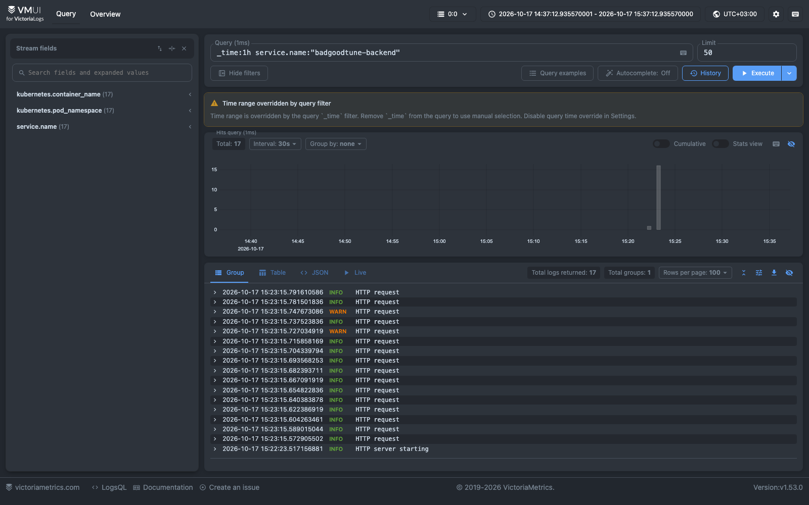
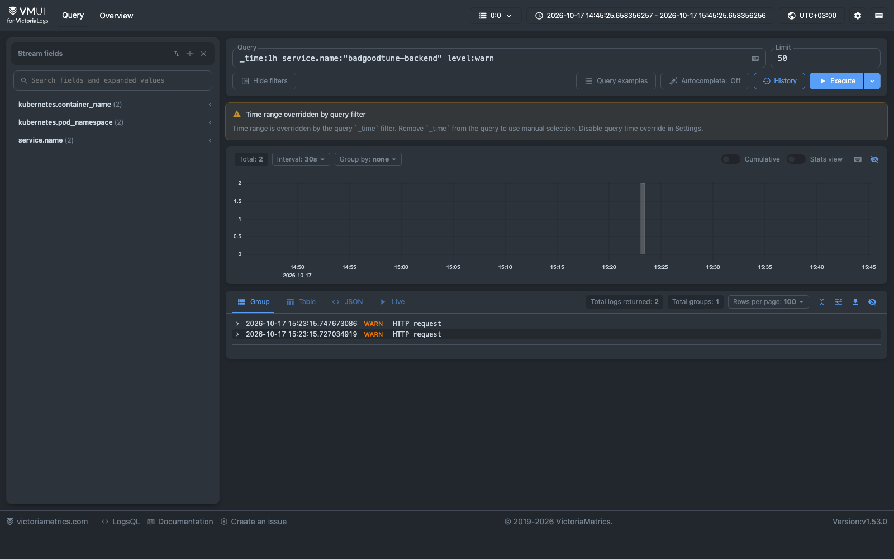
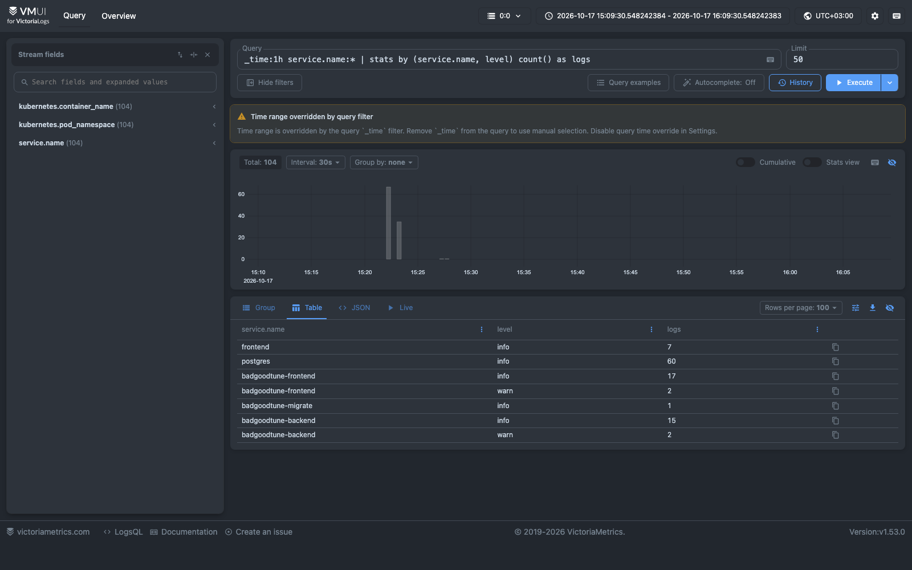
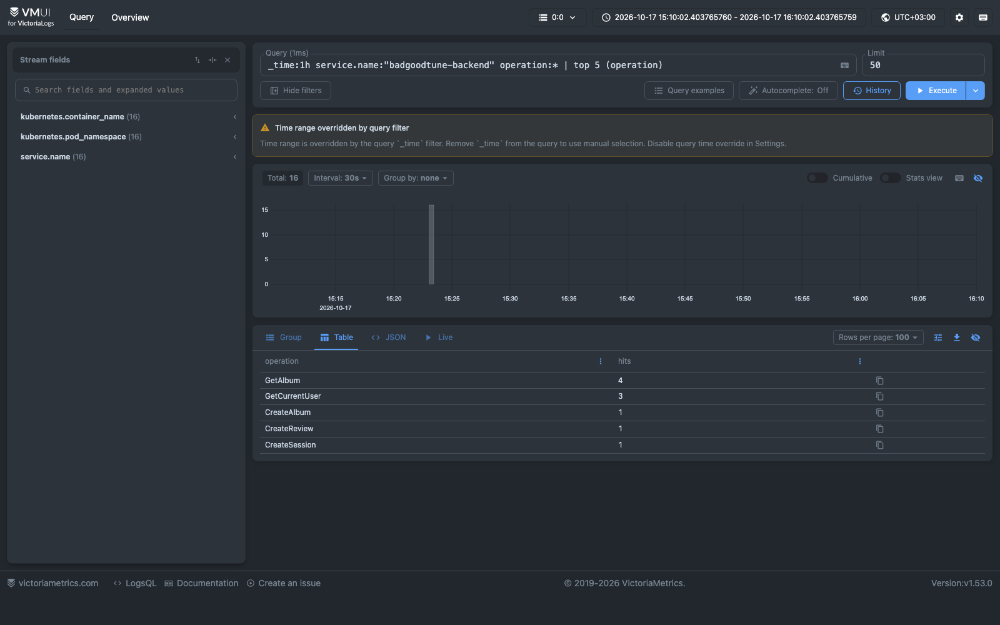
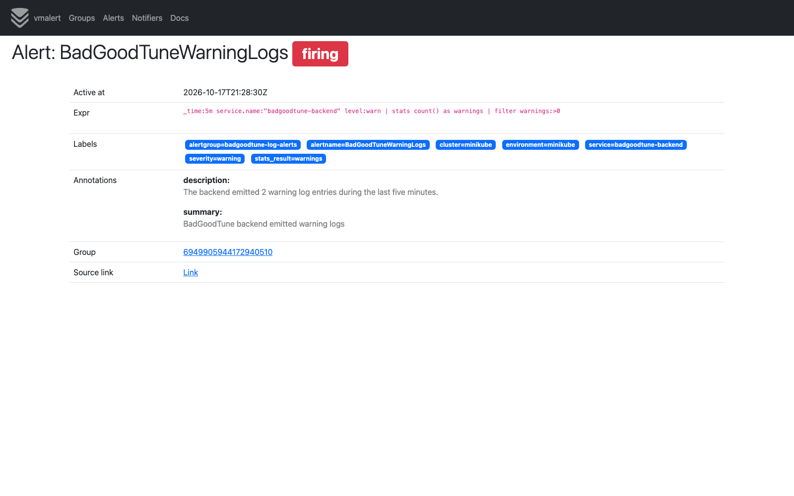

# Отчёт по домашнему заданию № 1

## Предметная область

BadGoodTune — общий каталог музыкальных альбомов. Посетитель может искать и просматривать альбомы и рецензии. После регистрации пользователь может добавить отсутствующий альбом, оставить одну рецензию с оценкой от 1 до 10, а также изменить или удалить созданные им данные.

В первой версии исполнитель хранится как поле альбома. Отдельные страницы исполнителей и список треков можно добавить позже, но для CRUD и следующих SRE-заданий они не нужны.

Основные сущности:

- `User` — учётная запись с уникальным именем и Argon2id-хешем пароля;
- `Session` — серверная сессия с ограниченным сроком жизни;
- `Album` — исполнитель, название, год выпуска, жанр и средняя оценка;
- `Review` — текст, оценка и автор. Один пользователь может оставить одну рецензию на альбом.

Для альбомов и рецензий реализованы create, read, update и delete. Каталог поддерживает поиск, фильтры, сортировку и cursor pagination. Уникальный индекс запрещает повторно добавлять один и тот же альбом.

## Стек

Backend написан на Go. Стандартного `net/http` достаточно для маршрутизации, поэтому дополнительный router не используется. HTTP/JSON проще для браузера и последующих работ по балансировке, чем gRPC с gateway.

Контракт хранится в OpenAPI. oapi-codegen создаёт серверные типы, а Hey API — TypeScript-клиент. PostgreSQL используется через pgx; sqlc генерирует типобезопасный Go-код из явных SQL-запросов; goose применяет версионированные миграции. Конфигурация читается из environment с помощью cleanenv и дополнительно проверяется в коде.

Для frontend выбраны Vue 3, TypeScript и Vite: этого достаточно для небольшого SPA с формами и маршрутизацией, при этом Node.js не нужен в runtime. Авторизация построена на отзываемых сессиях в PostgreSQL и `HttpOnly` cookie. JWT для одного backend не даёт преимущества и усложняет отзыв сессии.

## Архитектура

Приложение — модульный монолит с Clean Architecture:

```text
HTTP -> usecase -> domain
          |
          v
    repository interface <- PostgreSQL
```

`domain` содержит правила предметной области. `usecase` управляет сценариями и объявляет нужные ему интерфейсы. HTTP и PostgreSQL находятся во внешних слоях и преобразуют свои типы на границе. Конкретные реализации связываются только в `internal/app`. Поэтому транспорт или способ хранения можно заменить без изменения бизнес-правил.

## Twelve-Factor App

1. **Codebase.** Backend, frontend, миграции и инфраструктурные файлы находятся в одном Git-репозитории. Один commit задаёт одну версию приложения для всех окружений.

2. **Dependencies.** Go-зависимости зафиксированы в `go.mod` и `go.sum`, frontend-зависимости — в `package.json` и `package-lock.json`. Сборка не требует глобально установленных библиотек.

3. **Config.** DSN, адрес HTTP-сервера, параметры cookie, таймауты, размер пула и уровень логов задаются переменными окружения. Kubernetes-манифест содержит только локальные credentials; рабочие секреты должны поступать из внешнего хранилища.

4. **Backing services.** PostgreSQL подключается через `DATABASE_URL` и рассматривается как внешний ресурс. Его адрес можно изменить без изменения исходного кода.

5. **Build, release, run.** Backend и frontend собираются независимыми multi-stage Dockerfile. Миграции выполняются отдельным процессом перед запуском сервера; сервер сам схему не меняет.

6. **Processes.** HTTP-процесс не хранит пользовательское состояние в памяти. Пользователи, сессии, альбомы и рецензии находятся в PostgreSQL; файловая система контейнера доступна только для чтения.

7. **Port binding.** Go-сервер самостоятельно публикует API на `HTTP_ADDRESS`. Frontend отдаётся отдельным Nginx на порту 8080 и проксирует `/api` в backend.

8. **Concurrency.** Frontend и backend масштабируются независимо. Backend не требует sticky sessions, потому что сессии хранятся в PostgreSQL. Kubernetes Service распределяет запросы между готовыми репликами.

9. **Disposability.** На старте проверяются конфигурация и соединение с БД. SIGINT/SIGTERM запускает graceful shutdown с ограниченным таймаутом, после чего закрывается пул соединений.

10. **Dev/prod parity.** Локальная среда и интеграционные тесты используют PostgreSQL 17 и те же миграции, что и приложение. Полного соответствия production нет: в Compose отсутствуют production ingress, secret manager, HA и резервное копирование.

11. **Logs.** Сервер пишет структурированные JSON-события в stdout. Файлы логов не создаются; cookie, пароли и токены не логируются.

12. **Admin processes.** `cmd/migrate` собирается из той же кодовой базы и запускается как одноразовый процесс с той же конфигурацией подключения к БД.

## Запуск

```bash
docker compose up --build -d --wait
./scripts/smoke.sh
```

Интерфейс: <http://localhost:8080>. Liveness и readiness: `/health/live` и `/health/ready`.

# Домашнее задание № 2

## Использованные абстракции Kubernetes

- `Namespace` отделяет ресурсы приложения от остальных нагрузок кластера.
- `ConfigMap` хранит несекретные параметры, а `Secret` — локальные credentials PostgreSQL и DSN.
- `StatefulSet` запускает единственный экземпляр PostgreSQL со стабильным именем и хранилищем.
- `PersistentVolumeClaim` сохраняет данные PostgreSQL при пересоздании Pod.
- `Job` один раз применяет миграции перед запуском приложения.
- два `Deployment` независимо управляют stateless-репликами frontend и backend;
- внутренние `Service` дают PostgreSQL и backend постоянные DNS-имена, а `NodePort` открывает frontend из Minikube.

У контейнеров заданы resource requests и limits, security context, startup, readiness и liveness probes. Backend liveness проверяет только процесс, а readiness также проверяет PostgreSQL: при недоступности БД Pod исключается из балансировки, но не перезапускается.

## Взаимодействие сервисов

Браузер обращается к `badgoodtune-frontend`. Nginx отдаёт Vue SPA, а запросы `/api/*` проксирует в Service `backend`. Service распределяет их между готовыми Go Pod. Все backend-реплики используют PostgreSQL по имени `postgres`; данные и серверные сессии общие, поэтому sticky sessions не нужны.

Frontend и backend собираются в разные образы и масштабируются независимо. При проверке масштабирования backend увеличивается с одной до трёх реплик, frontend — с одной до двух. PostgreSQL остаётся в одной реплике: обычное увеличение StatefulSet без настройки репликации базы данных не создаёт корректный PostgreSQL-кластер.

Манифесты разделены на последовательные фазы: namespace, конфигурация, база данных, миграция, Service и приложение. Между фазами выполняются `rollout status` и `kubectl wait`, поскольку порядок файлов при `kubectl apply` не гарантирует готовность зависимостей.

Развёртывание рассчитано на локальный одноузловой Minikube. Оно не обеспечивает высокой доступности узла, TLS, резервное копирование PostgreSQL и безопасную доставку production-секретов.

Образы собираются локальным Docker и загружаются командой `minikube image load`. Сборка после `eval "$(minikube docker-env)"` также проверена, но это альтернативный способ: построенный во внутреннем daemon образ уже доступен Kubernetes и не нуждается в повторной загрузке.

# Домашнее задание № 3

## Сбор и хранение логов

VictoriaLogs single-node развёрнута официальным Helm chart `victoria-logs-single` версии `0.13.10` в отдельном namespace `observability`. Данные хранятся в PVC размером 2 GiB; срок хранения ограничен семью днями, а объём — 1 GiB. Service `victoria-logs` доступен только внутри кластера, vmui открывается локально через `kubectl port-forward`.

Vector запущен как `DaemonSet`: на каждом узле работает один агент, который читает стандартные Kubernetes container logs из `/var/log/pods`. Такой способ не требует встраивать шиппер в каждый Pod и автоматически охватывает новые реплики приложения. Vector оставляет события только из namespace `badgoodtune`, разбирает JSON и отправляет их в Elasticsearch bulk endpoint VictoriaLogs.

Backend, migration и frontend пишут логи в stdout. Основные поля JSON: `timestamp`, `level`, `message`, `service.name`; HTTP-события также содержат `request_id`, method, operation или path, status и duration. В stream fields включены только namespace, container и `service.name`: это полезные поля с низкой кардинальностью. Имя Pod остаётся обычным полем, чтобы масштабирование не создавало отдельный stream для каждой реплики.

## LogsQL-запросы

### 1. Сырые backend-логи за последний час

```logsql
_time:1h service.name:"badgoodtune-backend"
```

Запрос показывает последние события backend. На скриншоте видны структурированные уровни, сообщения и график количества событий.



### 2. Фильтр по уровню

```logsql
_time:1h service.name:"badgoodtune-backend" level:warn
```

Запрос оставляет только предупреждения backend. В данном запуске это ожидаемые ответы `401` и `404`, которые создаёт проверочный CRUD-сценарий.



### 3. Группировка по сервису и уровню

```logsql
_time:1h service.name:* | stats by (service.name, level) count() as logs
```

`stats` считает события для каждой пары сервис/уровень. Результат позволяет сравнить объём логов компонентов и сразу увидеть наличие предупреждений.



### 4. Самые частые операции backend

```logsql
_time:1h service.name:"badgoodtune-backend" operation:* | top 5 (operation)
```

`top` показывает пять наиболее частых API-операций. Поле `operation` содержит стабильный OpenAPI operation ID, поэтому результат полезнее группировки по URL с идентификаторами ресурсов.



## Бонус: алерт по логам

В namespace `observability` дополнительно развёрнуты vmalert `v1.153.0` и Alertmanager `v0.34.0`. vmalert раз в 15 секунд выполняет LogsQL-запрос к VictoriaLogs:

```logsql
_time:5m service.name:"badgoodtune-backend" level:warn
| stats count() as warnings
| filter warnings:>0
```

Правило основано на запросе с фильтром `level:warn`, приведённом выше. Оно переходит в состояние `firing`, если за последние пять минут backend создал хотя бы одно предупреждение. Порог намеренно выбран низким для воспроизводимой локальной проверки: CRUD smoke создаёт ожидаемые ответы `401` и `404`. В production порог следовало бы определить из SLO и нормального уровня клиентских ошибок.

Alertmanager принимает алерт, группирует его по имени и сервису и направляет в локальный receiver без внешней интеграции. Slack, email или PagerDuty не настроены, поскольку для них потребовались бы пользовательские credentials и отдельная политика маршрутизации. Состояние Alertmanager хранится в `emptyDir`: для локального single-node окружения этого достаточно, но production-инсталляции нужны устойчивое хранение и несколько реплик.

Команда `make alerts-trigger` генерирует тестовый трафик и через API vmalert проверяет, что `BadGoodTuneWarningLogs` перешёл в состояние `firing`. На скриншоте значение `2` соответствует двум warning-событиям проверочного сценария.



# Домашнее задание № 4

## Стек и сбор

VictoriaMetrics single `v1.154.0` установлена официальным Helm chart `victoria-metrics-single` версии `0.49.0` в namespace `observability`. Конфигурация находится в `deploy/observability/victoria-metrics-values.yaml`. Данные хранятся на PVC 2 GiB, retention — 7 дней. Single-node сервер сам собирает метрики; отдельный vmagent не требуется.

Backend использует `prometheus/client_golang v1.25.0`: готовые Go/process collectors, собственные бизнес-метрики и HTTP-метрики. `promhttp` обслуживает `/metrics` на отдельном порту `9090` с поддержкой согласования OpenMetrics. Основной API остаётся на `8080`; frontend metrics endpoint не проксирует. Метрики доступны без cookie внутри кластера; наружу мониторинг открывается локальным port-forward.

Включён Kubernetes Pod discovery. Аннотации `prometheus.io/scrape`, `prometheus.io/port`, `prometheus.io/path` находятся в шаблонах Pod backend и postgres-exporter. Relabeling оставляет только аннотированные контейнеры и соответствующие metrics-порты, поэтому каждая backend-реплика собирается отдельно. ServiceAccount VictoriaMetrics получает через Role/RoleBinding только `get/list/watch` Pod в namespace `badgoodtune`. Интервал сбора — 15 секунд, таймаут — 5 секунд.

## PostgreSQL

`prometheuscommunity/postgres-exporter:v0.20.1` работает отдельным Deployment в namespace `badgoodtune`, подключается к Service `postgres` и экспортирует статистику на `9187`. Отдельный Pod позволяет обновлять экспортер без перезапуска БД. Перед его запуском Job создаёт или обновляет роль `badgoodtune_monitor` с `pg_monitor`; пароль поступает из Secret. Этот шаг повторяемый и работает на существующем PVC. Роль не имеет superuser, CREATEDB/CREATEROLE или прав чтения таблиц пользователей.

Экспортируются `pg_up`, статистика подключений, транзакций и другие стандартные показатели PostgreSQL. `up` показывает успех HTTP-сбора, а `pg_up` — доступность самой БД. При проверке контролируются оба уровня.

## Бизнес-метрики

| Метрика | Тип | Событие |
|---|---|---|
| `badgoodtune_users_registered_total` | Counter | Успешно созданы пользователь и его первая сессия |
| `badgoodtune_logins_total` | Counter | Успешный отдельный вход и создание сессии; регистрация не учитывается |
| `badgoodtune_albums_created_total` | Counter | Успешно сохранён новый альбом |
| `badgoodtune_reviews_created_total` | Counter | Успешно сохранена новая рецензия |
| `badgoodtune_review_score` | Histogram | Оценка от 1 до 10 при первоначальной публикации рецензии |

Метрики обновляются после успешной операции хранения. Ошибки, конфликты, редактирование и удаление не увеличивают счётчики создания. Изменение оценки не добавляет новое наблюдение в гистограмму. Наблюдение вызывается через интерфейсы usecase; слой usecase не импортирует Prometheus.

HTTP-инструментирование дополнительно экспортирует `badgoodtune_http_requests_total`, `badgoodtune_http_request_duration_seconds` и `badgoodtune_http_requests_in_flight`. Labels ограничены операцией OpenAPI и статусом; health probes исключены. Идентификаторы пользователей и объектов, произвольные URL и тексты в labels не включаются.

Counters принадлежат процессу и сбрасываются при его перезапуске. Это показатели наблюдаемой активности, а не точный реестр объектов в БД; между scrape или при аварийном завершении события могут теряться. Для скорости используются `rate()`/`increase()` по отдельным series с последующей агрегацией.

## Проверка

```bash
make metrics-status
make metrics-check
make metrics-targets
make metrics-query METRICS_QUERY='go_goroutines{job="badgoodtune-backend"}'
make metrics-query METRICS_QUERY='pg_up{job="postgres"}'
make metrics-generate
make metrics-query METRICS_QUERY='sum(rate(badgoodtune_reviews_created_total[5m]))'
```

`metrics-check` проверяет текущее число здоровых целей, наличие runtime и бизнес-метрик каждой backend-реплики, `pg_up=1` и статистику PostgreSQL в TSDB. `metrics-generate` фиксирует исходные значения, выполняет полный CRUD и ждёт их изменения: четыре счётчика увеличиваются на 1, `_count` гистограммы — на 1, `_sum` — на 9. После изменения оценки на 8 и удаления рецензии гистограмма по-прежнему описывает её публикацию с оценкой 9. Проверка требует отсутствия параллельного трафика и перезапусков backend.

Через `make metrics-open` доступны `/targets` и `/vmui/` на `127.0.0.1:8428`. На записи демонстрируются workloads, обнаруженные цели и результаты запросов к сохранённым метрикам.

## Ограничения

Single-node Minikube не обеспечивает HA и резервного копирования. PVC сохраняет историю при пересоздании Pod, но не при удалении namespace. Размер PVC не является жёсткой дисковой квотой hostPath Minikube. В репозитории заданы только локальные credentials; для production нужны внешняя доставка секретов и отдельная настройка сетевого доступа. Grafana и новые правила алертинга в эту работу не входят; сбор логов и существующий log-based алерт продолжают работать отдельно.
